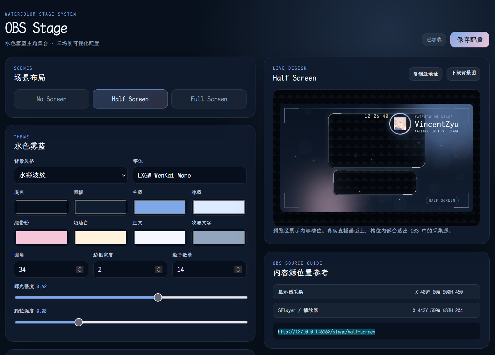
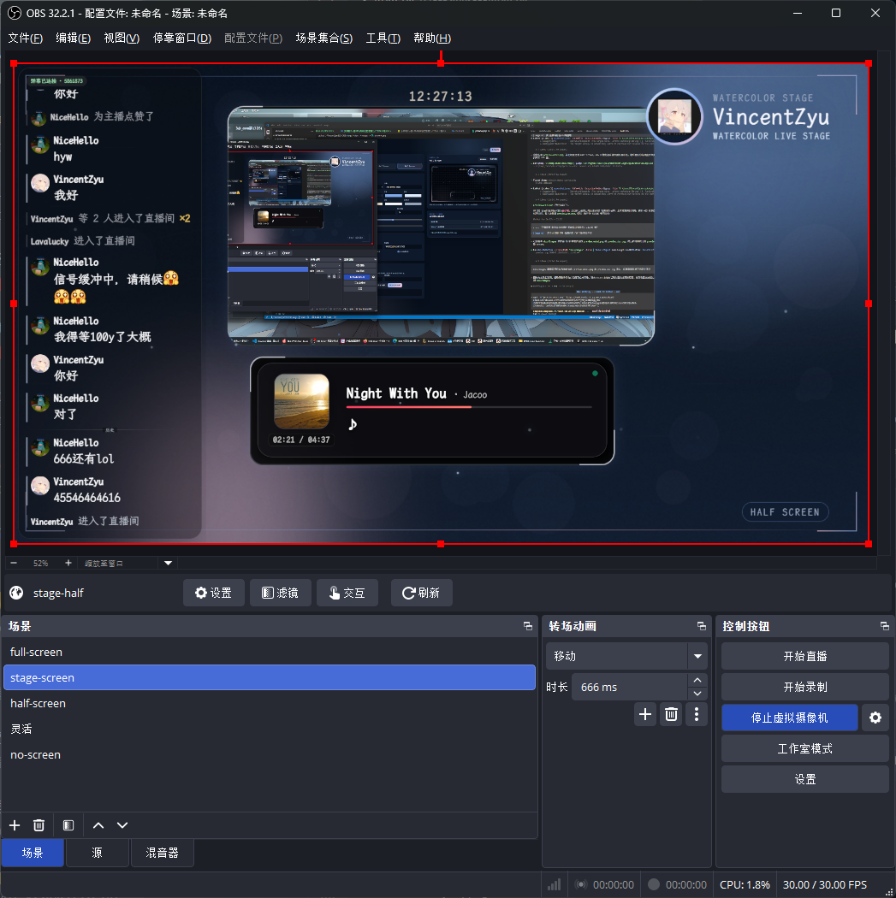

# 🌊 OBS Stage

<p align="center">
  
</p>

给 OBS 直播间增加一套可编辑的水色雾蓝主题舞台。OBS 负责采集与合成，浏览器中的 WebUI 负责背景、圆角边框、头像徽章、标题和轻动态装饰。

> [!TIP]
> 当前是初版自用阶段，欢迎通过 Issue 或 PR 反馈问题、布局建议和主题需求。

## 🖼️ 预览

### 🎛️ WebUI



### 🎬 OBS 半屏实机



## ✨ 能力

- 三套独立布局：`no-screen`、`half-screen`、`full-screen`
- 水色雾蓝主题，可调整完整调色板、背景风格、圆角、辉光、粒子与字体
- 内置 LXGW WenKai Mono Medium（SIL OFL 1.1），WebUI 和舞台默认统一使用霞鹜文楷
- 支持上传头像并作为舞台品牌徽章
- WebUI 提供 16:9 实时设计预览和内容源位置参考
- 可选 OBS WebSocket：测试连接、抓取真实场景截图、一键创建或更新舞台层
- 一键套用只管理 `Stage BG` 和 `Stage Frame`，不移动现有采集、播放器或弹幕
- 背景为静态 PNG，前景为轻量 Browser Source；场景隐藏时可关闭浏览器源
- 配置、头像和导出背景存放在应用数据目录，不进入 Git

## 🚀 启动

需要 [uv](https://docs.astral.sh/uv/)；Python 3.12 或更新版本由 uv 管理。

```bash
uv sync
uv run obs-stage
```

控制台默认打开：

```text
http://127.0.0.1:6162/admin
```

### 🖥️ 桌面启动

双击 `scripts/start-obs-stage.cmd` 即可检查并启动本地服务；如果服务已经运行，只会打开 WebUI。安装后的桌面快捷方式名为 `OBS Stage`，关闭控制台窗口即可停止服务。

## 🎛️ OBS 分层

推荐每个场景按以下顺序叠加：

```text
1. Stage BG [scene]       WebUI 导出的静态背景图
2. 显示器采集 / 窗口采集 / SPlayer
3. Stage Frame [scene]    WebUI 的透明前景浏览器源
4. 弹幕浏览器源
5. 通知、字幕等临时层
```

舞台前景在内容槽位处透明，在槽位外绘制背景、圆角边框、标题、头像和轻动态装饰。浏览器源不能直接显示 OBS 内部的采集画面，因此必须由 OBS 把真实内容夹在背景层和前景层之间。

完整步骤见 [docs/obs-setup.md](docs/obs-setup.md)。

## 🔌 可选 OBS WebSocket

在 OBS 的“工具 → WebSocket 服务器设置”中启用服务器，然后把地址和密码填入 WebUI。WebUI 可以：

- 测试连接并读取场景列表
- 抓取当前场景真实截图
- 为当前场景或全部场景创建/更新舞台层
- 已存在的舞台源会更新，不会重复创建

密码只保留在页面内存或 `OBS_WEBSOCKET_PASSWORD` 环境变量中，不写入配置文件。更多说明见 [docs/obs-websocket.md](docs/obs-websocket.md)。

## 📁 布局

- `no-screen`：中央主播放器卡，顶部品牌栏，无弹幕槽位。
- `half-screen`：左侧固定弹幕，右侧主采集卡和横向播放器卡。
- `full-screen`：全屏采集内容，左侧固定弹幕，右下悬浮播放器。

三个舞台页原生使用 `1600×900` 的 16:9 设计坐标；OBS 浏览器源宽高请设置为 `1600×900`。坐标见 [docs/layout-spec.md](docs/layout-spec.md)。

## 🗂️ 数据位置

Windows 默认：

```text
%LOCALAPPDATA%\VincentZyu-OBS-stage\
```

macOS 与 Linux 使用各自的平台应用数据目录。可用 `--data-dir` 覆盖。

## 🛠️ 开发

```bash
uv sync
uv run ruff check .
uv run mypy src
uv run pytest -q
```

跨平台进程采样：

```bash
uv run scripts/measure_processes.py --name python --name obs-browser-page --seconds 10
```

## 📄 License

MIT。页面与桌面快捷方式使用“OBS Studio logo + VincentZyu233 GitHub 头像”组合图标；其中 OBS logo 派生资源按 GPL-2.0 单独分发，来源与许可说明见
[src/obs_stage/static/assets/OBS-LOGO-NOTICE.md](src/obs_stage/static/assets/OBS-LOGO-NOTICE.md)。
